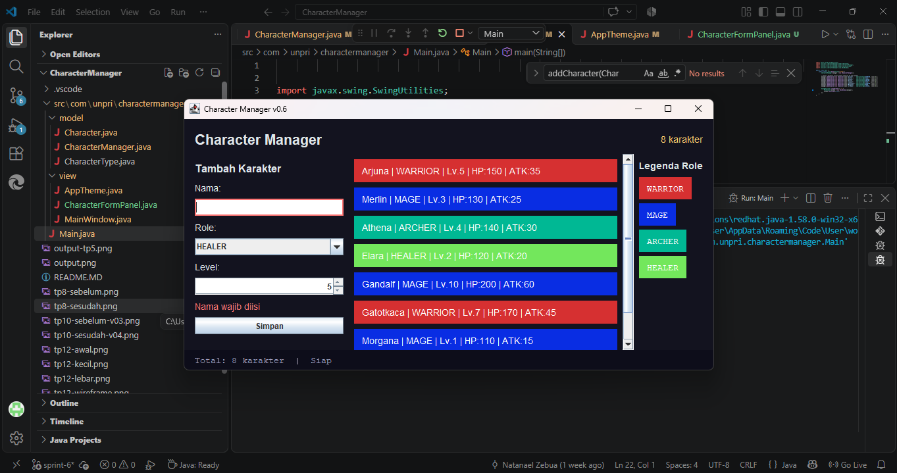
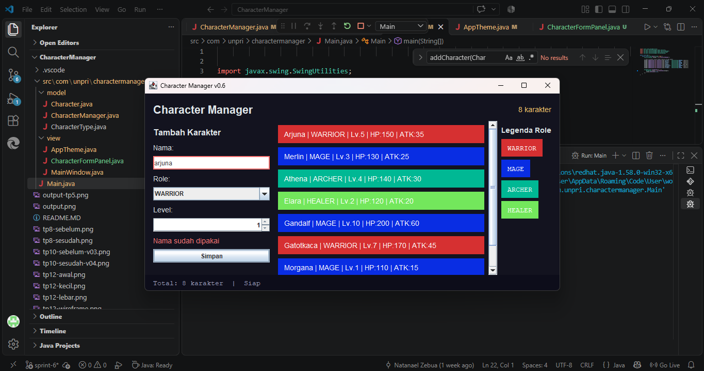
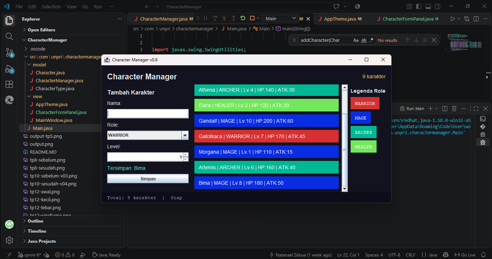
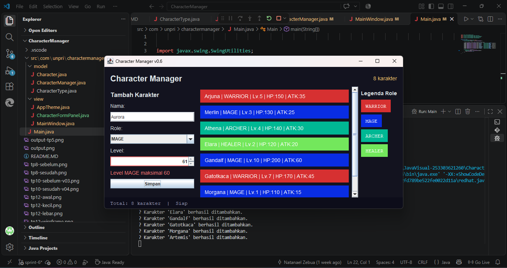
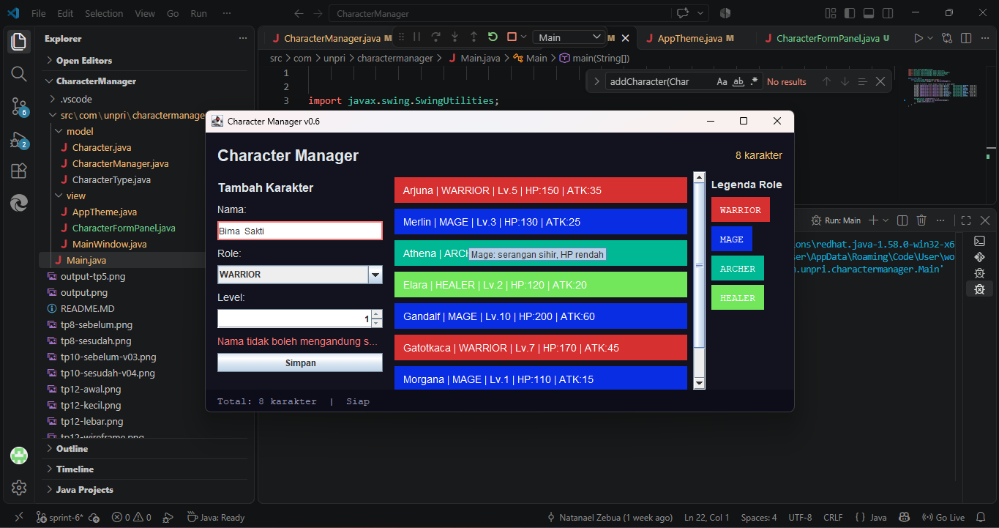

# Character Manager — TP14 (Java Visual SIH-6406)

Pada sprint ini (v0.5 ke v0.6), aplikasi Character Manager ditingkatkan dari sekadar penampil data menjadi alat kerja interaktif yang mampu menerima input karakter baru melalui CharacterFormPanel di wilayah WEST (JTextField, JComboBox, dan JSpinner). Perubahan juga dilakukan pada package model untuk menegakkan aturan bisnis di konstruktor Character serta pemeriksaan keunikan nama di CharacterManager, disertai validasi berlapis dan pembaruan daftar otomatis lewat refreshList().

# Screenshot

Error nama kosong (pesan inline merah, border merah, kursor kembali ke field nama):


Error nama sudah dipakai (deteksi duplikat case-insensitive):


Input valid berhasil disimpan (kartu baru langsung muncul & pesan hijau):


Bukti Mini-Challenge (aturan konsistensi MAGE maksimal level 60 dari Model):


Bukti aturan baru (larangan spasi ganda di View):


### Tabel Uji (Matriks Input)

| No | Input | Hasil Diharapkan | Hasil Nyata | Lapisan yang Menangkap |
| :--- | :--- | :--- | :--- | :--- |
| 1 | Nama: `(kosong)` | Pesan `"Nama wajib diisi"`, border merah di field nama, kursor kembali ke field | Sesuai harapan; jumlah karakter tetap 8[cite: 6] | View (`validateName` — kelengkapan)[cite: 1] |
| 2 | Nama: `"   "` (hanya spasi) | Dianggap kosong setelah `trim()`, pesan `"Nama wajib diisi"` | Sesuai harapan; spasi tepi dibersihkan lalu ditolak[cite: 1] | View (`trim()` + `validateName`)[cite: 1] |
| 3 | Nama: `Ab` (2 huruf) | Pesan `"Nama harus 3-20 karakter"`, border merah | Sesuai harapan; ditolak sebelum masuk Model[cite: 1] | View (`validateName` — panjang)[cite: 1] |
| 4 | Nama: `Arjuna123` | Pesan `"Nama hanya huruf dan spasi"`, border merah | Sesuai harapan; angka ditolak oleh regex `[A-Za-z ]+`[cite: 1] | View (`validateName` — format)[cite: 1] |
| 5 | Nama: `arjuna` (huruf kecil) | Pesan `"Nama sudah dipakai"`, border merah | Sesuai harapan; terdeteksi sama dengan `"Arjuna"`[cite: 7] | Model (`CharacterManager.isNameTaken`)[cite: 1] |
| 6 | Nama: `Bima`, Role: `MAGE`, Level: `8` | Tersimpan; kartu baru muncul di daftar; pesan hijau `"Tersimpan: Bima"`; form di-reset | Sesuai harapan; total karakter naik menjadi 9[cite: 5] | Lolos semua lapisan (Sukses)[cite: 1] |
| 7 | Nama: 21 huruf (`Abcdefghijklmnopqrstu`) | Pesan `"Nama harus 3-20 karakter"`, border merah | Sesuai harapan; melebihi batas maksimal 20 karakter[cite: 1] | View (`validateName` — panjang)[cite: 1] |
| 8 | Nama: `"  Bima Sakti  "` | Tersimpan sebagai `"Bima Sakti"` tanpa spasi berlebih di awal/akhir | Sesuai harapan; spasi tepi dibuang oleh `trim()`[cite: 1] | View (`trim()`) $\rightarrow$ Model |
| 9 | Level: ketik `500` di `JSpinner` lalu Simpan | Tidak ada karakter level > 99 yang masuk ke daftar | Saat Simpan ditekan, `commitEdit()` otomatis mengembalikan nilai spinner ke batas maksimum `99` sehingga level 500 tidak pernah terkirim | View (`SpinnerNumberModel` + `commitEdit()`)[cite: 1] |
| 10 | Nama: `Aurora`, Role: `MAGE`, Level: `61` *(Mini-Challenge)* | Ditolak dengan pesan `"Level MAGE maksimal 60"` dan border merah pada level | Sesuai harapan; pesan dari Model tampil otomatis tanpa mengubah `CharacterFormPanel`[cite: 1, 4] | Model (Konstruktor `Character`)[cite: 1] |
| 11 | Nama: `Bima  Sakti` *(Aturan Baru 1 — spasi ganda)* | Pesan `"Nama tidak boleh mengandung spasi ganda"`, border merah pada nama | Pesan error tampil dan karakter ditolak, namun teks pada `messageLabel` terpotong menjadi `"Nama tidak boleh mengandung s..."` karena lebar panel kiri `250px`[cite: 8] | View (`validateName` — format) |
| 12 | Tambah karakter ke-16 saat daftar berisi 15 karakter *(Aturan Baru 2)* | Ditolak dengan pesan `"Daftar penuh (maksimal 15 karakter)"` | Sesuai harapan; penambahan dibatalkan dan pesan dari Model tampil di form | Model (`CharacterManager.addCharacter`) |

**Catatan Pengamatan & Tindakan Perbaikan:**
1. **Perilaku `JSpinner` pada input `500`:** `SpinnerNumberModel(1, 1, 99, 1)` menjaga rentang saat `commitEdit()` dipanggil sehingga angka di luar rentang otomatis dikembalikan ke nilai sah terakhir atau batas maksimum `99`[cite: 1]. Jika ada jalur lain di luar form yang mencoba membuat karakter level `500`, konstruktor `Character` tetap menolaknya dengan `IllegalArgumentException`[cite: 1].
2. **Teks error terpotong pada aturan spasi ganda:** Pada pengujian kasus ke-11, pesan `"Nama tidak boleh mengandung spasi ganda"` terpotong elipsis (`...`) karena lebar `CharacterFormPanel` ditetapkan `250px`[cite: 1, 8]. Tindakan perbaikannya adalah mempersingkat teks pesan menjadi `"Tidak boleh ada spasi ganda"` agar seluruh kalimat terbaca utuh di dalam panel.

---

### Dua Aturan Validasi Baru & Alasan Penempatannya

1. **Larangan Spasi Ganda pada Nama — Diletakkan di View (`CharacterFormPanel.validateName`)**
   * **Implementasi:** Menambahkan pemeriksaan `if (name.contains("  ")) return "Nama tidak boleh mengandung spasi ganda";` di dalam `validateName()`.
   * **Alasan:** Pengecekan spasi ganda merupakan aturan format penulisan masukan keyboard pengguna di antarmuka form (sejajar dengan validasi panjang dan karakter huruf/spasi), sehingga layak disaring langsung di lapisan **View** sebelum objek karakter dibuat[cite: 1].

2. **Batas Maksimal 15 Karakter dalam Daftar — Diletakkan di Model (`CharacterManager.addCharacter`)**
   * **Implementasi:** Menambahkan pemeriksaan `if (getTotalCharacters() >= 15) throw new IllegalArgumentException("Daftar penuh (maksimal 15 karakter)");` pada awal method `addCharacter()`.
   * **Alasan:** Kapasitas penyimpanan koleksi karakter adalah aturan bisnis (*domain rule*) milik `CharacterManager` yang tetap masuk akal meskipun aplikasi berjalan tanpa GUI[cite: 1]. Dengan meletakkannya di **Model**, aturan ini melindungi daftar dari sumber data mana pun dan pesannya otomatis ditangkap oleh `catch (IllegalArgumentException ex)` di form tanpa mengubah kode `CharacterFormPanel`[cite: 1].

---

### Kompromi Arsitektur Sementara

Pada Sprint #6 ini terdapat dua kompromi sementara yang sengaja dilakukan agar fokus tetap pada alur input dan validasi berlapis[cite: 1]. Pertama, tombol `Simpan` dan `nameField` menggunakan `addActionListener(e -> onSave())` secara langsung di dalam kelas View, bukan melalui kelas pengendali terpisah[cite: 1]. Kedua, `CharacterFormPanel` memanggil `manager.addCharacter()` secara langsung sehingga View masih berinteraksi langsung dengan Model[cite: 1]. Kedua kompromi ini akan dirapikan pada Pertemuan 9 dengan memindahkan penanganan event dan koordinasi pembaruan data ke lapisan **Controller**[cite: 1].

---

### Struktur Panel Bersarang (`MainWindow` v0.6)

`MainWindow` menggunakan `BorderLayout` dengan lima wilayah yang terisi penuh[cite: 1]:
* **NORTH:** `header` (`BorderLayout`) yang memuat judul aplikasi di `WEST` dan `countLabel` di `EAST`[cite: 1].
* **WEST:** `CharacterFormPanel` (`BorderLayout`) dengan lebar tetap `250px`, menampung panel `rows` (`GridLayout 0x1`) di posisi `NORTH` agar tinggi komponen input tetap alami dan tidak melar[cite: 1].
* **CENTER:** `JScrollPane` yang membungkus `holder` (`BorderLayout`), dengan `cardsPanel` (`GridLayout 0x1`) di posisi `NORTH` untuk menampung kartu karakter `JLabel` yang diperbarui lewat `refreshList()`[cite: 1].
* **EAST:** `legend` (`BoxLayout Y_AXIS`) yang menampilkan chip warna tiap `CharacterType`[cite: 1].
* **SOUTH:** `status` (`FlowLayout LEFT`) yang menampilkan `statusLabel` jumlah karakter aktif[cite: 1].

```text
MainWindow (JFrame, BorderLayout)
├── NORTH  : header (BorderLayout) -> judul (WEST), countLabel (EAST)
├── WEST   : CharacterFormPanel (BorderLayout, 250px)
│   └── NORTH : rows (GridLayout 0x1) -> title, nameField, roleBox, levelSpinner, messageLabel, saveButton
├── CENTER : JScrollPane
│   └── holder (BorderLayout)
│       └── NORTH : cardsPanel (GridLayout 0x1) -> kartu karakter (JLabel)
├── EAST   : legend (BoxLayout Y_AXIS) -> strut, chip per CharacterType, glue
└── SOUTH  : status (FlowLayout LEFT) -> statusLabel
```

## Struktur Folder
```text
CharacterManager/
├── src/
│   └── com/
│       └── unpri/
│           └── charactermanager/
│               ├── model/
│               │   ├── Character.java
│               │   ├── CharacterManager.java
│               │   └── CharacterType.java
│               ├── view/
│               │   ├── AppTheme.java
│               │   ├── CharacterFormPanel.java
│               │   └── MainWindow.java
│               └── Main.java
├── README.MD
├── output-tp5.png
├── output.png
├── tp8-sebelum.png
├── tp8-sesudah.png
├── tp10-sebelum-v03.png
├── tp10-sesudah-v04.png
├── tp12-awal.png
├── tp12-kecil.png
├── tp12-lebar.png
├── tp12-wireframe.png
├── tp14-error-duplikat.png
├── tp14-error-kosong.png
├── tp14-error-spasi-ganda.png
├── tp14-minichallenge.png
└── tp14-sukses.png
```

## Identitas & Analisis Bagian D
Nama : Natanael Lata Saro Agassi Zebua  

Nim : 253303621260

## Analisis Input & Validasi (Google Docs):
 https://docs.google.com/document/d/1efobC0cZH8Rm_6eTrHLGNNAHG9pYlCmq/edit?usp=drive_link&ouid=114985403171917953493&rtpof=true&sd=true