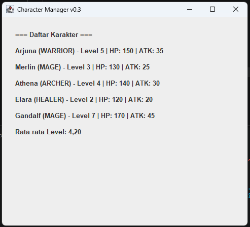
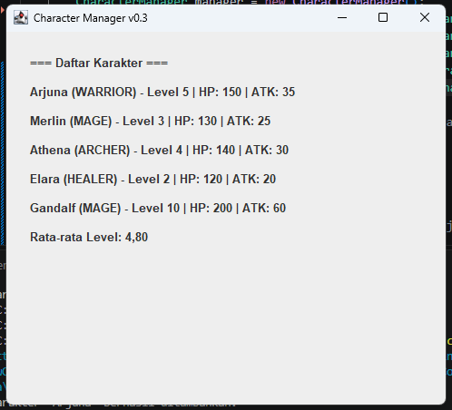

# TP8 — Character Manager Sprint #3
Pada sprint ini aplikasi berpindah dari console ke GUI. Ditambahkan class MainWindow (package view, extends JFrame) yang menampilkan daftar karakter secara dinamis lewat loop, ditambah statistik "Rata-rata Level" di bawah daftar. Main.java menjalankan jendela lewat SwingUtilities.invokeLater().

## Screenshot MainWindow
Sebelum data diubah (Gandalf level 7, rata-rata level 4.20):

Sesudah data diubah (Gandalf level 10, rata-rata level 4.80):

Kedua screenshot memuat 5 karakter dan membuktikan bahwa statistik ikut berubah saat data diubah.

## Aliran data: Main → CharacterManager → MainWindow
Main.java membuat CharacterManager dan mengisinya dengan lima karakter (Model). Data diambil lewat manager.getAllCharacters(), yang mengembalikan salinan list, lalu diteruskan ke constructor MainWindow. MainWindow (View) hanya menerima list itu, membuat satu JLabel untuk setiap karakter lewat loop, dan menampilkan rata-rata level, tanpa mengetahui cara data disimpan. Dalam MVC, Main untuk sementara berperan sebagai penghubung (pengganti Controller yang dibangun pada pertemuan berikutnya): Model tidak mengenal View, dan View tidak mengubah data Model.

## Karakter baru
| Karakter | Tipe | Level | Alasan pemilihan |
| :--- | :--- | :--- | :--- |
| **Elara** | HEALER | 2 | Melengkapi empat tipe karakter (sebelumnya belum ada HEALER) dan level rendah agar datanya bervariasi |
| **Gandalf** | MAGE | 7, lalu diubah menjadi 10 | Level tinggi sehingga pengaruhnya pada rata-rata level terlihat jelas saat data diubah |

## Struktur folder
```text
CharacterManager/
│
├── src/
│   └── com/
│       └── unpri/
│           └── charactermanager/
│               ├── model/
│               │   ├── Character.java
│               │   ├── CharacterManager.java
│               │   └── CharacterType.java
│               │
│               ├── view/
│               │   └── MainWindow.java
│               │
│               └── Main.java
│
├── output-tp5.png
├── output.png
├── tp8-sebelum.png
├── tp8-sesudah.png
└── README.md
```

## Analisis Bagian D TP8 (Google Docs)
https://docs.google.com/document/d/1P2E1Vt90Tm4gVKWp6zVS8HTPDeWaj57T_hBUxTMtxhY/edit?usp=drive_link